# Hi there 👋

My name is Ayaz and:

- 🤝 I'm a maintainer of [Jupyter Docker Stacks](https://github.com/jupyter/docker-stacks)
- 🤩 [Jupyter Distinguished Contributor](https://jupyter.org/about#2022-cohort)
- 🌱 Always learning `C++`, `Python`, `Docker`, `Linux`
- 👯 Looking to collaborate on `C++`-based projects
- 🤝 Former community reviewer of [conan-center-index](https://github.com/conan-io/conan-center-index)
- 💬 Ask me about `Docker`
- 📫 How to reach me: `@mathbunnyru` basically everywhere
- ⚡ Fun fact: `std::unordered_set<int>(n).bucket_count()` is a funny way to find a prime which is at least `n`.

